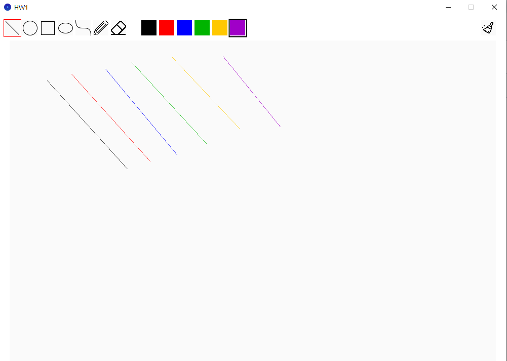
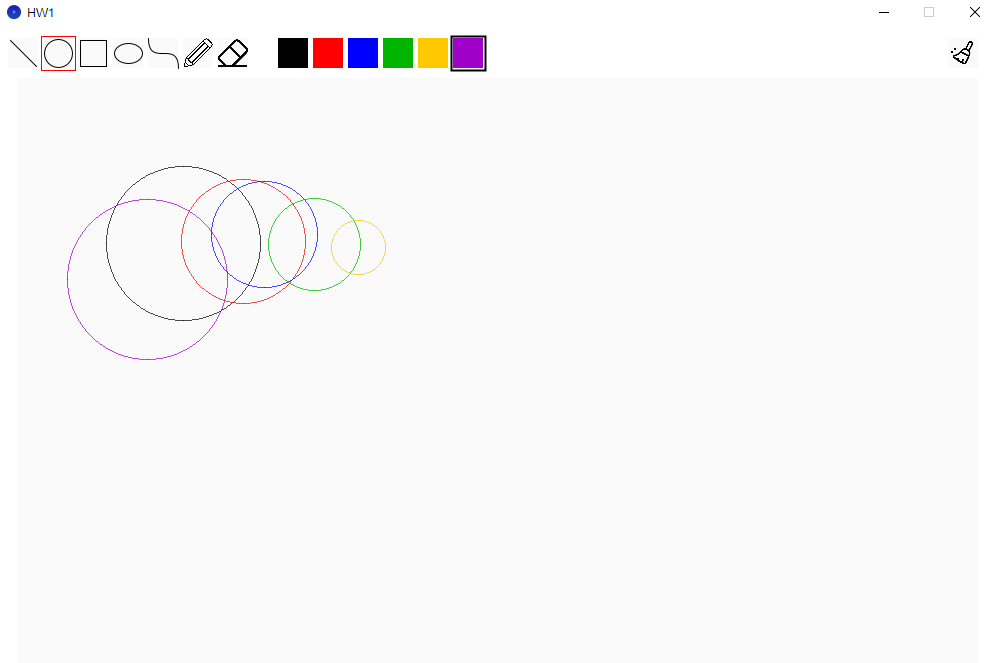
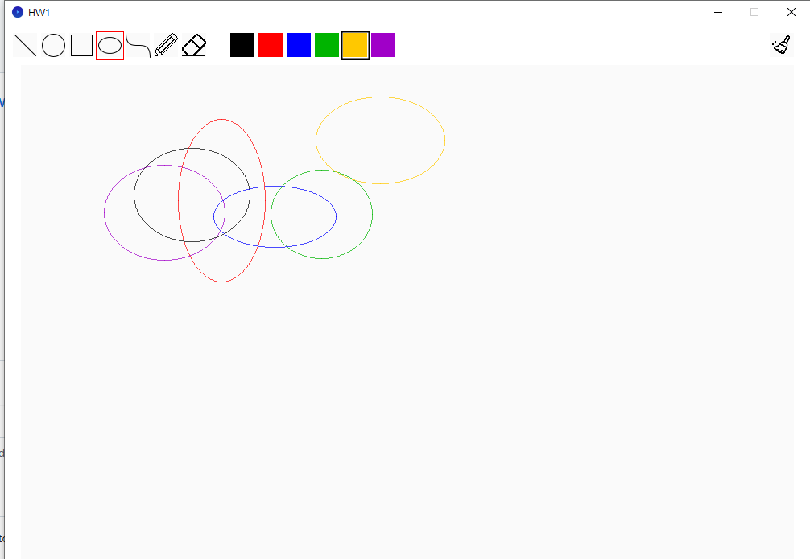
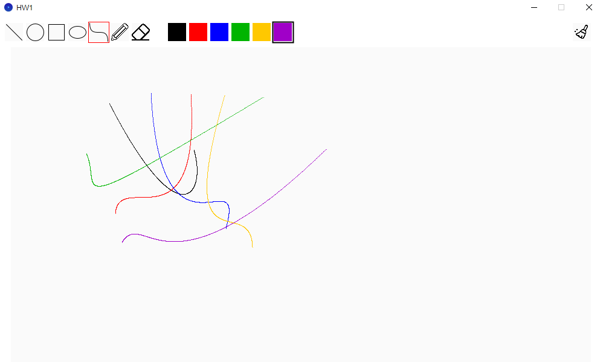
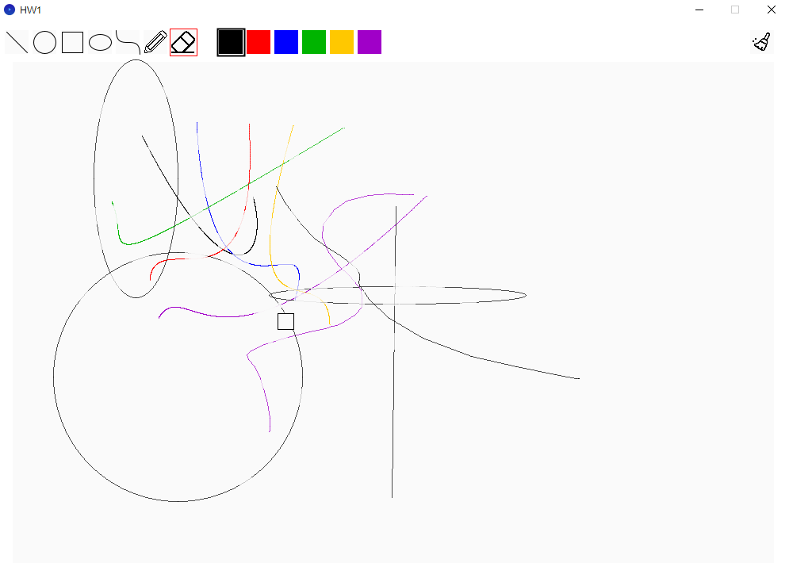

# 115522154_computerGraphic_HW1
## Completed Tasks
- line algorithm
- circle algorithm
- ellipse algorithm
- curve algorithm
- eraser
### Bonus
- Six-color Palette

## Screenshot
| Line | Circle | Ellipse |Curve | Eraser |
|:---:|:---:|:---:|:---:|:---:|
|  |  |  |  |  |

## Implementation
### Drawing Algorithm
| Shape | Algorithm |
|---|---|
| Line | Slpoe-based Line Rasterization |
| Circle | Midpoint Circle |
| Ellipse | Midpoint Ellipse |
| Curve | Bézier |

#### Slpoe-based Line Rasterization Algorithm

For line drawing, I used a slope-based algorithm similar to DDA.

First, I round the coordinates of the two endpoints to integers. Then, I calculate `dx` and `dy` to determine whether the line is more horizontal or vertical.

- If `dx >= dy`, I increase x by 1 each time and calculate the corresponding y value using the slope.
- Otherwise, I increase y by 1 each time and calculate the corresponding x value.

Finally, I round the calculated coordinates and use `drawPoint()` to draw each pixel.

I also added a condition to handle the case where both endpoints are the same, so the program can draw a single point without dividing by zero.

#### Midpoint Circle Algorithm

For circle drawing, I used the Midpoint Circle Algorithm.

First, I round the radius to an integer and initialize the decision parameter `p = 1 - radius`.

In each iteration, I check the value of `p` to decide whether the next pixel should move right (E) or diagonally down-right (SE). Then, I update the decision parameter for the next iteration.

Since a circle has eight-way symmetry, I only need to calculate the points in one part of the circle and use `drawPoint()` to draw the other seven symmetric points.

The loop continues until `dx > dy`, which means the required part of the circle has been completed.

#### Midpoint Ellipse Algorithm

For ellipse drawing, I used the Midpoint Ellipse Algorithm.

The algorithm is divided into two regions because the slope of the ellipse changes.

- In Region 1, I increase `dx` and use the decision parameter `p1` to choose between E and SE.
- In Region 2, I decrease `dy` and use `p2` to choose between S and SE.

Since an ellipse has four-way symmetry, I only need to calculate the points in one part of the ellipse and use `drawPoint()` to draw the other three symmetric points.

The algorithm continues until `dy` becomes less than 0.

#### Bézier Curve Algorithm

For curve drawing, I used the Cubic Bézier Curve algorithm.

The curve is defined by four points: a start point, two control points, and an end point.

First, I divide the parameter `t` from 0 to 1 into 1000 steps. For each step, I calculate the x and y coordinates using the cubic Bézier curve formula.

Then, I use `drawPoint()` to draw each calculated point.

By changing the positions of the control points, I can create curves with different shapes.

#### Eraser

For the eraser function, I used `color(250)` to draw over the existing shapes.

Since the background color is also white color, the covered parts look like they have been erased.

This method does not actually delete the shapes. It just covers them with the background color.

#### Bonus - Six-color Palette 

To implement the six-color palette, I made the following changes:

- Added six color buttons for users to select different colors.
- Added a `currentPenColor` variable to store the currently selected color.
- Modified the drawing functions to pass the selected color using the `color c` parameter.
- Added a `shapeColor` variable to each shape so that previously drawn shapes keep their original colors.

When the user selects a different color, only the new shapes will use that color.

## LLM Assistance

I used ChatGPT to understand the project structure,
implement color selection, help organize the structure of my README.md and improve the English descriptions., and debug errors.
I reviewed the changes and tested the code in Processing.

